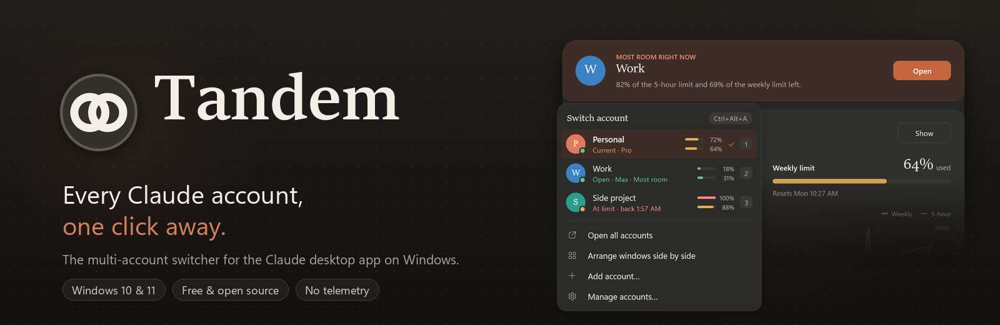
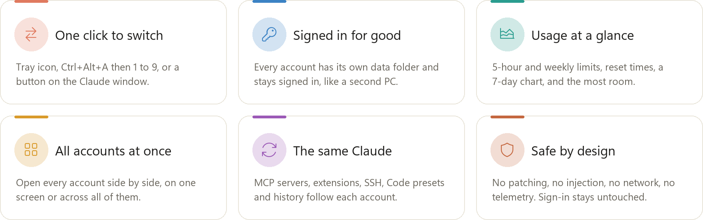
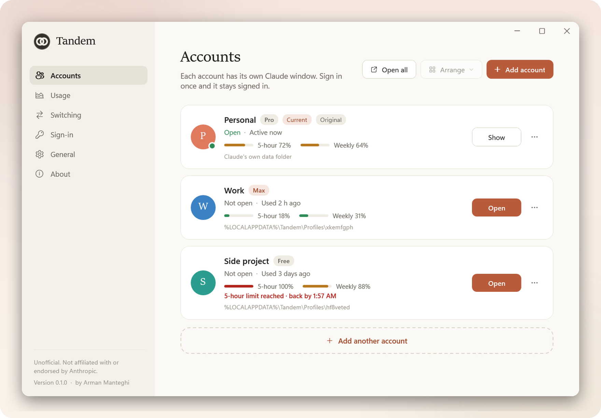
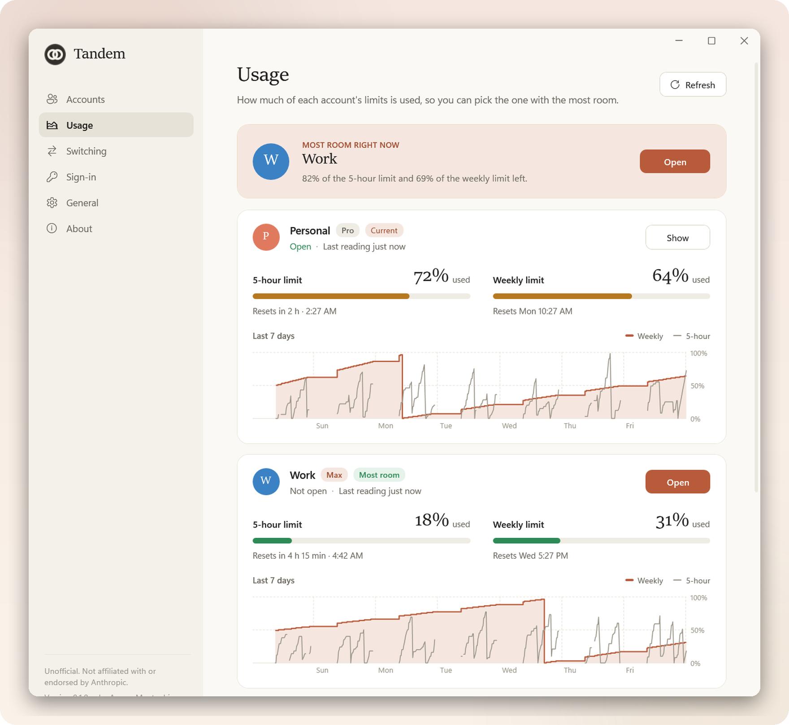
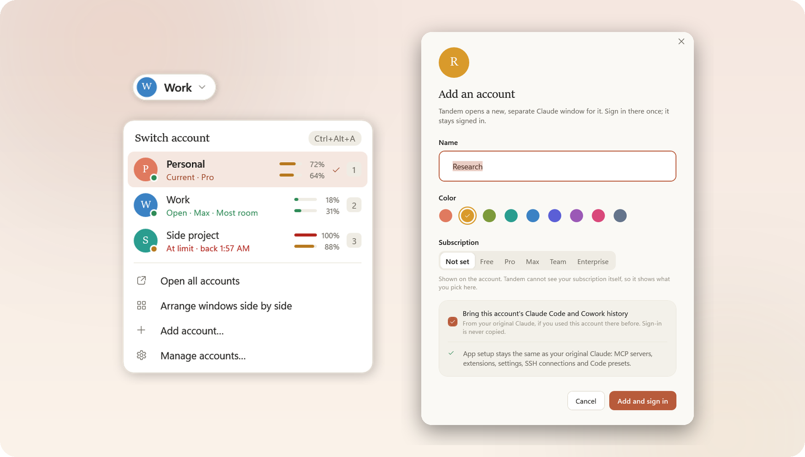
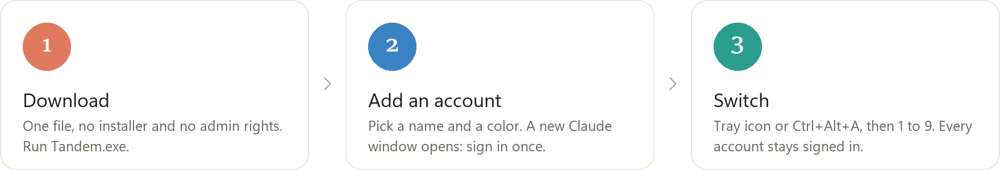
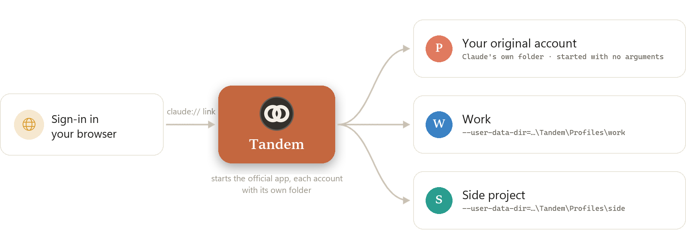

<p align="center">
  
</p>

<h3 align="center">Use multiple Claude accounts on Windows, and switch between them in one click.</h3>

<p align="center">
  Tandem is a free, open-source <b>Claude multi-account switcher</b>. Every Claude account, whether personal, work, Pro, Max or Team,
  gets its own Claude desktop window that stays signed in, with Claude Code, your usage limits and one-click switching.
</p>

<p align="center">
  <a href="https://github.com/Arman-Manteghi/Tandem/releases/latest/download/Tandem.exe"></a>
</p>

<p align="center">
  <a href="https://github.com/Arman-Manteghi/Tandem/releases/latest"></a>
  <a href="https://github.com/Arman-Manteghi/Tandem/actions/workflows/ci.yml"></a>
  <a href="https://github.com/Arman-Manteghi/Tandem/releases"></a>
  
  
  
  <a href="LICENSE"></a>
</p>

<p align="center">
  <a href="#-download">Download</a> ·
  <a href="#-screenshots">Screenshots</a> ·
  <a href="#-getting-started">Getting started</a> ·
  <a href="#-features">Features</a> ·
  <a href="#-how-it-works">How it works</a> ·
  <a href="#-privacy-and-safety">Privacy</a> ·
  <a href="#-faq">FAQ</a>
</p>

> [!NOTE]
> **Unofficial.** Tandem is not affiliated with or endorsed by Anthropic. It starts the official Claude desktop app exactly as installed, and never patches, injects into or redistributes it.

---

## ✨ Why Tandem

The Claude desktop app works with one account at a time. If you have more than one, for example
a personal and a work account or a team seat next to your own plan, switching means signing out,
signing in again and losing your place.

Tandem runs **multiple Claude accounts side by side** instead. Each one has its own window that
stays signed in, they are all one click apart, and you can always see how much of each account's
limits is left.

<picture>
  <source media="(prefers-color-scheme: dark)" srcset="docs/images/readme/features-dark.png">
  
</picture>

---

## 📥 Download

<p>
  <a href="https://github.com/Arman-Manteghi/Tandem/releases/latest/download/Tandem.exe"></a>
  &nbsp;
  <a href="https://github.com/Arman-Manteghi/Tandem/releases"></a>
</p>

1. **Download [`Tandem.exe`](https://github.com/Arman-Manteghi/Tandem/releases/latest/download/Tandem.exe).** It is a single file: no installer, no .NET to install, no administrator rights.
2. **Move it into a folder of its own**, for example `%LOCALAPPDATA%\Programs\Tandem`.
3. **Double-click it.** Tandem opens and its icon appears in the tray. Choose **General → Add to Start menu** and start Tandem from there from now on.

| | Requirement |
|---|---|
| 🪟 **Windows** | Windows 10 (version 2004 or later) or Windows 11, 64-bit |
| 🤖 **Claude** | The [Claude desktop app](https://claude.ai/download), installed for your Windows user |
| 📦 **Anything else** | Nothing |

> [!TIP]
> Releases are not code-signed yet, so Windows SmartScreen may show *Windows protected your PC*. Choose **More info → Run anyway**.
> To check your download, compare `Get-FileHash .\Tandem.exe` in PowerShell with the SHA-256 on the release page.

---

## 📸 Screenshots

<picture>
  <source media="(prefers-color-scheme: dark)" srcset="docs/images/readme/accounts-dark.png">
  
</picture>
<p align="center"><sub><b>Accounts.</b> Every Claude account with its status, subscription and usage.</sub></p>

<picture>
  <source media="(prefers-color-scheme: dark)" srcset="docs/images/readme/usage-dark.png">
  
</picture>
<p align="center"><sub><b>Usage.</b> Both Claude limits for every account, when they reset, the last 7 days, and the account with the most room.</sub></p>

<picture>
  <source media="(prefers-color-scheme: dark)" srcset="docs/images/readme/switcher-dark.png">
  
</picture>
<p align="center"><sub><b>Switcher, switch button and Add account.</b> Open the switcher from the tray or with <kbd>Ctrl</kbd>+<kbd>Alt</kbd>+<kbd>A</kbd>.</sub></p>

---

## 🚀 Getting started

<picture>
  <source media="(prefers-color-scheme: dark)" srcset="docs/images/readme/steps-dark.png">
  
</picture>

**Add an account.** Click **Add account**, pick a name, a color and (optionally) the subscription. A new, separate Claude window opens.

**Sign in once.** Claude signs you in through your browser, which hands the result back with a `claude://` link. Windows normally sends those links to your original account, so the first time, Tandem sets up its **sign-in helper**:

- Tandem adds its own entries to your Windows user settings (only its own keys, never Claude's, no administrator rights).
- Windows Settings opens on Tandem's page: click the box next to **CLAUDE** and choose **Tandem**. Windows lets only you make this choice. Tandem notices it and continues by itself.
- When the browser asks to open the app, choose **Open**: the sign-in lands in the new window. That is the only time you sign in.

**Switch.**

| To | Do this |
|---|---|
| ⚡ Open the switcher | Click the tray icon, or press <kbd>Ctrl</kbd>+<kbd>Alt</kbd>+<kbd>A</kbd> |
| 🎯 Pick an account | Click it, or press its number <kbd>1</kbd>–<kbd>9</kbd> |
| ⌨️ Move through the list | <kbd>↑</kbd> <kbd>↓</kbd>, then <kbd>Enter</kbd>; <kbd>Esc</kbd> closes |
| ⚙️ Manage accounts and settings | Double-click the tray icon |

> [!IMPORTANT]
> Start Tandem from the Start menu or Explorer, not from a terminal inside Claude. Programs started inside Claude share its sandbox; Tandem notices and restarts itself outside it.

---

## 🧩 Features

### ⚡ Switching

- **One click:** a running account comes to the front instantly; a closed one starts.
- **Keyboard first:** <kbd>Ctrl</kbd>+<kbd>Alt</kbd>+<kbd>A</kbd> opens the switcher anywhere (you can change it), <kbd>1</kbd>–<kbd>9</kbd> picks an account.
- **Same place:** an account that opens takes the size and position of the window you are in.
- **Your choice of flow:** leave the previous window open, minimize it, or close it, so it feels like one window changing accounts.
- **Switch button:** an optional pill with the account's name and color on the Claude window in front, or on every Claude window. Drag it to any corner; it stays there.

### 🪟 Several accounts side by side

- **Open all** starts every account that is not open yet.
- **Arrange** tiles the open windows on the current screen, or spreads them across all your screens, respecting each monitor's scale.
- Every window is the full desktop app, signed in to its own account, and they all work at the same time.

### 📊 Usage and limits

The Claude app saves its own usage readings about every 15 minutes. Tandem shows them for every account:

- **5-hour and weekly limits** with meters that turn amber, then red, as they fill up.
- **Reset times**, worked out from the readings: the 5-hour window ends five hours after its first message, and the weekly limit resets at the same time each week. *By 8:10 PM* means at the latest.
- **The last 7 days** as a chart. Point at it to see any reading.
- **Most room right now:** the account with the most left of its tighter limit, with a button to switch to it. When every account is at a limit, Tandem shows the one that is back first.
- **A notification** when the account you are in reaches a limit, naming the account with the most room.
- **A warning** if two of your accounts are signed in to the same Claude account and therefore share one set of limits.

### 🧩 The same Claude in every account

<details>
<summary><b>App setup that follows automatically</b> (on by default)</summary>

<br>

Before an added account opens, it gets your original Claude's current setup. Only new or changed files are copied, and the previous version of every replaced file is kept in `%LOCALAPPDATA%\Tandem\Backups`.

| Kept the same | File |
|---|---|
| MCP servers and app preferences | `claude_desktop_config.json` |
| MCP tool toggles | `mcp-user-tool-toggles.json` |
| Desktop extensions and their settings | `Claude Extensions\`, `Claude Extensions Settings\` |
| SSH connections for the Code tab | `ssh_configs.json` |
| Code tab presets | `ccd-session-presets.json` |

</details>

<details>
<summary><b>Claude Code and Cowork history</b></summary>

<br>

Claude keeps this history inside its data folder, one sub-folder per account. If you used an account in your original Claude before, *Add account* brings its history over (or later, **⋯ → Bring Code history from your original Claude**). Files the account already has are kept; a file is only replaced by a newer, longer copy.

| Brought over | Folder or file |
|---|---|
| Claude Code sessions | `claude-code-sessions\` |
| Cowork sessions and skills | `local-agent-mode-sessions\` |
| Worktrees used by Code sessions | `git-worktrees.json` (only if the account has none) |

</details>

<details>
<summary><b>Claude Code itself, even on restricted networks</b></summary>

<br>

The Code tab runs a Claude Code program that the app downloads into each account's folder. Some networks and VPNs are refused by the download server, and the app then shows *Couldn't download Claude Code*. Your original account keeps working with the version it downloaded earlier; a new account has none.

Tandem gives every added account the newest Claude Code another account already has, checked against the SHA-256 that Claude recorded for it, and hard-linked so it takes no extra disk space. It only ever adds a missing version.

</details>

**Never copied:** sign-in data, cookies, tokens, web storage, `config.json` and device identity. The lists above are fixed in the code ([`ProfileSetup.cs`](src/Tandem.Core/Profiles/ProfileSetup.cs)) and covered by tests.

### 🎨 Everything else

Rename, recolor and set the subscription of each account · per-account desktop and Start menu shortcuts · start with Windows · light and dark themes that follow Windows · deleting an account moves its folder to the Recycle Bin, never further.

---

## 🔧 How it works

Tandem launches the **official, unmodified** Claude desktop app with a separate data folder for each account:

```text
claude-desktop.exe --user-data-dir="%LOCALAPPDATA%\Tandem\Profiles\<id>"
```

<picture>
  <source media="(prefers-color-scheme: dark)" srcset="docs/images/readme/how-it-works-dark.png">
  
</picture>

The app keeps everything (sign-in, settings, cache) in its data folder, so a different folder is a different, independent account. Your original account starts with no arguments at all.

- **No patching, no injection, no debugging switches.** The app's files are never touched, so its updates and code signing keep working. Tandem finds the app through the execution alias its package declares, at every launch.
- **Everything you see is Tandem's own window.** The switch button follows the Claude window with standard out-of-process accessibility events, and switching is ordinary window management.
- **Windows' package sandbox is handled.** Account folders are created by Tandem itself before the app first sees them, and checked afterwards, so Windows never redirects them into the app's private storage.

The details, including how the package, the data folders and `claude://` links behave, are in [docs/FINDINGS.md](docs/FINDINGS.md).

---

## 🔐 Privacy and safety

- 🌐 **No network connections, no telemetry, no automatic updates.** Tandem itself never talks to the internet.
- 🔑 **Sign-in data is never read, copied or sent.** That covers cookies, tokens and session storage of every account.
- 📋 **What Tandem copies:** only the allow-listed setup and history files and the Claude Code program described above, byte for byte.
- 👀 **What Tandem reads:** each account's `plan-usage-history.json` for the Usage page (read-only, values never logged), and two switches of running Claude processes (`--type` and `--user-data-dir`) to tell windows apart. Command lines are never stored or logged.
- 🗝️ **What Tandem writes to Windows:** only its own registry keys for the optional sign-in helper, and shortcuts you ask for.
- 📝 **Logs** (`%LOCALAPPDATA%\Tandem\logs`) contain account ids only: no names, no links, no user name. They are kept for 10 days.
- ♻️ **Nothing is deleted permanently.** Removed accounts, replaced files and shortcuts go to the Recycle Bin.

Full details: [PRIVACY.md](PRIVACY.md).

---

## 🚧 Limitations

- **Chats, Projects, memory and connectors belong to each Claude account** and live on Anthropic's servers, exactly as when switching accounts inside the app.
- **Code history is per account by Claude's own design.** Tandem brings an account's existing history over; your files and `%USERPROFILE%\.claude` are shared by all accounts anyway.
- **Setup follows when an account starts.** A change made in your original Claude reaches an account that is already open the next time it starts.
- **Claude in Chrome** talks to the account that started last, because every instance registers itself with the browser extension.
- Only one instance can own one of the app's global shortcuts, such as quick entry.
- Cowork's virtual machine service is shared by all instances.
- Windows only.

---

## ❓ FAQ

<details>
<summary><b>How do I use multiple Claude accounts on Windows?</b></summary>
<br>
Install Tandem, click <b>Add account</b>, and sign in once in the new Claude window. Each account keeps its own data folder, so it stays signed in, and you switch between accounts from the tray icon or with <kbd>Ctrl</kbd>+<kbd>Alt</kbd>+<kbd>A</kbd>.
</details>

<details>
<summary><b>Can I run two Claude desktop accounts at the same time?</b></summary>
<br>
Yes. Every account runs as its own instance of the official Claude desktop app, in its own window. <b>Open all</b> starts them all, and <b>Arrange</b> puts the windows side by side, on one screen or across several.
</details>

<details>
<summary><b>How do I switch Claude accounts without signing out?</b></summary>
<br>
With Tandem you never sign out: each account stays signed in to its own window. Switching just brings the other account's window to the front, or starts it.
</details>

<details>
<summary><b>Does Claude Code work in every account?</b></summary>
<br>
Yes. Every account is the full desktop app, Code tab included. Tandem also brings each account's existing Claude Code and Cowork history over, keeps MCP servers and extensions the same, and shares a working Claude Code program when the download is blocked on your network.
</details>

<details>
<summary><b>Is Tandem made by Anthropic?</b></summary>
<br>
No. Tandem is an independent, unofficial project. It is not affiliated with or endorsed by Anthropic.
</details>

<details>
<summary><b>Will a Claude update break it? Does it change my original Claude?</b></summary>
<br>
No and no. Tandem never changes the app: it finds it through the app's own execution alias at every launch, so updates are picked up automatically. Your original account starts exactly as before, with no arguments; Tandem only reads from its folder.
</details>

<details>
<summary><b>Is it allowed to use several accounts?</b></summary>
<br>
That is decided by Anthropic's terms for your accounts, so please check them. Tandem only runs the official app, each account with its own folder. It does not hide, fake or change anything about your device or your accounts.
</details>

<details>
<summary><b>The Code tab says "Couldn't download Claude Code".</b></summary>
<br>
The download server refuses some networks and VPNs. Tandem gives an added account the newest Claude Code another account already has, before it opens. If none of your accounts has one yet, open your original account once on a network that works.
</details>

<details>
<summary><b>Where is my data, and how do I uninstall?</b></summary>
<br>

- Settings: `%APPDATA%\Tandem`. Account folders, logs and backups: `%LOCALAPPDATA%\Tandem`.
- To uninstall: turn off the sign-in helper (**Sign-in → Turn off**), turn off *Start with Windows*, quit Tandem from the tray and delete `Tandem.exe`. Delete the two `Tandem` folders too if you want to remove the added accounts. Your original Claude is not affected.

</details>

---

## 🔨 Build from source

Requires the [.NET 8 SDK](https://dotnet.microsoft.com/download/dotnet/8.0).

```powershell
git clone https://github.com/Arman-Manteghi/Tandem.git
cd Tandem
dotnet test                                            # unit tests
dotnet run --project src/Tandem.App                    # run it
dotnet publish src/Tandem.App -c Release -o publish    # the single Tandem.exe
```

`Tandem.exe --render-previews docs/images` (add `dark` for the dark theme) renders every window with sample data, and `python tools/readme-assets.py .` builds the README images from those screenshots.

| Folder | Contents |
|---|---|
| `src/Tandem.Core` | Accounts, launching, process inspection, link routing, setup sync, usage, Claude Code sharing |
| `src/Tandem.App` | The WPF tray app: switcher, switch button, Manage window, usage charts, sign-in helper |
| `tests/Tandem.Core.Tests` | xUnit tests |
| `tools/` | The icon generator (`Tandem.IconGen`) and the README image builder |
| `docs/FINDINGS.md` | How the Claude app behaves on Windows, and what Tandem relies on |

---

## 🧭 Roadmap

- [ ] Code-signed releases
- [ ] More AI coding apps, starting with editors built on VS Code (Cursor, Windsurf)
- [ ] Separate profiles for command-line tools (Claude Code CLI, Codex CLI)

Ideas and bug reports are welcome in [Issues](https://github.com/Arman-Manteghi/Tandem/issues).

---

## 🤝 Contributing

Contributions are welcome. Start with the [contributing guide](CONTRIBUTING.md): it explains the
setup, the tests, and the ground rules every change keeps.

| Document | What it covers |
|---|---|
| 📋 [Changelog](CHANGELOG.md) | What changed in each release |
| 🔒 [Security policy](SECURITY.md) | How to report a vulnerability privately |
| 🕵️ [Privacy](PRIVACY.md) | Exactly what Tandem stores and reads |
| 💬 [Code of conduct](CODE_OF_CONDUCT.md) | How we treat each other here |
| 📦 [Third-party notices](THIRD-PARTY-NOTICES.md) | Components included in `Tandem.exe` |

---

## 👤 Author

<p align="center">
  <b>Arman Manteghi</b><br>
  <sub>Designed and built Tandem</sub><br><br>
  <a href="https://github.com/Arman-Manteghi"></a>
</p>

<p align="center">If Tandem saves you time, a ⭐ on the repository helps other people find it.</p>

## 📄 License

[MIT](LICENSE) © 2026 Arman Manteghi.

Tandem is unofficial and not affiliated with or endorsed by Anthropic. "Claude" is a trademark of Anthropic.
